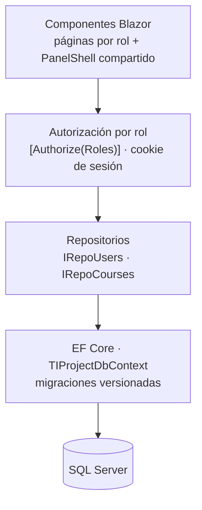
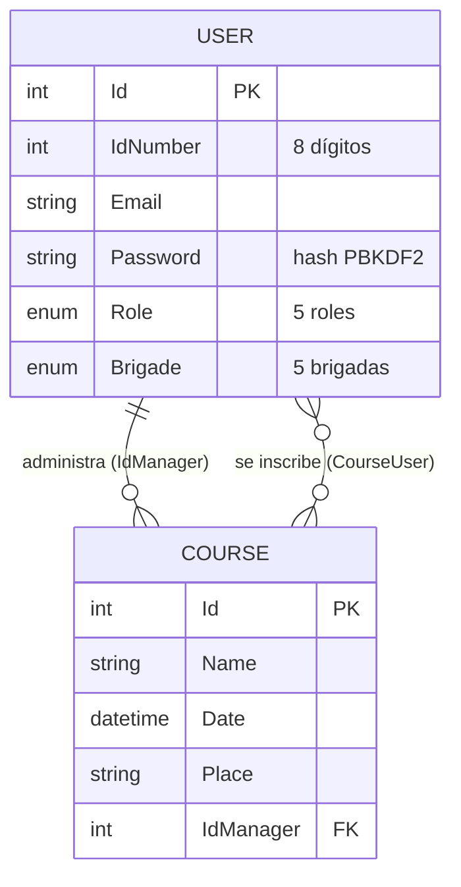

# Protección Civil Universitaria — Sistema de gestión de brigadas

> **EN:** University civil-protection platform: brigades, trainings and enrollments with 5-role RBAC enforced on the server. Blazor Server (.NET 8), EF Core, SQL Server, layered design with a repository layer.

Plataforma web para la Brigada Universitaria de Protección Civil de la Universidad de Colima. Centraliza el padrón de brigadistas, las capacitaciones, los boletines informativos y los documentos oficiales, con un panel distinto para cada rol.

## Funcionalidades

- **Sitio público:** inicio con galería, servicios, boletines descargables y catálogo de capacitaciones.
- **Autenticación por rol:** inicio de sesión con número de identificación de 8 dígitos, reCAPTCHA y redirección al panel de cada perfil.
- **5 roles con panel propio:** Administrador, Jefe de Brigada, Brigadista, Auxiliar y Estudiante, todos con el mismo diseño (componente `PanelShell`).
- **Padrón de usuarios:** alta, edición y asignación a una de las 5 brigadas (Primeros Auxilios, Evacuación, Combate de Incendios, Búsqueda y Rescate, Comunicación).
- **Capacitaciones:** creación de cursos con encargado, fecha y lugar. Brigadistas y estudiantes se inscriben o cancelan desde su panel, y el administrador ve cuántos inscritos tiene cada curso.
- **Gestor documental:** carga de boletines y documentos por categoría con validación en servidor.

## Arquitectura

Aplicación monolítica en capas sobre Blazor Server. Cada capa tiene una sola responsabilidad y solo conoce a la de abajo:



- **Presentación:** los 8 paneles comparten el componente `PanelShell` (barra lateral, encabezado, modo oscuro y menú según el rol), así que un cambio de diseño se hace en un solo lugar.
- **Acceso a datos:** las páginas nunca usan el `DbContext` directamente; pasan por interfaces de repositorio registradas en el contenedor de inyección de dependencias. Eso permite probarlas con una base en memoria.
- **Reglas de negocio en el modelo:** `User` y `Course` implementan `IValidatableObject` (por ejemplo, un brigadista debe tener brigada y el encargado de un curso debe ser administrador).
- **Seguridad en el servidor:** el rol se lee siempre de la base de datos, nunca de lo que envía el formulario.

### Modelo de datos



- La inscripción es una relación muchos a muchos (tabla `CourseUser`), creada con una migración que conserva los datos existentes.
- Borrar a un administrador no borra sus cursos: la relación del encargado usa `DeleteBehavior.Restrict`.

## Seguridad

El proyecto pasó por una auditoría SecDevOps documentada en [`docs/security`](docs/security/README.md) (matriz de activos, árbol de ataque, modelo de amenazas STRIDE con 33 amenazas). Controles implementados a partir de ese análisis:

- Contraseñas con hash PBKDF2 (`PasswordHasher`) y migración automática de contraseñas antiguas en texto plano.
- Autorización por rol con `[Authorize(Roles = ...)]` en cada panel; el rol se toma siempre de la base de datos, nunca del formulario.
- Cookie de sesión `HttpOnly`, `SameSite=Strict` y expiración deslizante de 30 minutos.
- Límite de 5 intentos de inicio de sesión por minuto por dirección IP (rate limiting) y reCAPTCHA.
- Cabeceras de seguridad HTTP (`X-Frame-Options`, `X-Content-Type-Options`, `Referrer-Policy`, `Permissions-Policy`).
- Carga de archivos con lista blanca de extensiones, detección de doble extensión, verificación de *magic bytes* y límite de 20 MB.

## Stack

- C# · ASP.NET Core **Blazor Server** (.NET 8)
- Entity Framework Core 9 con migraciones · SQL Server (LocalDB)
- Bootstrap 5 · CSS propio con modo oscuro · Font Awesome

## Estructura

```
TIProject/
├── Components/Pages/   Páginas Blazor (inicio, login, paneles por rol, usuarios, cursos, documentos)
├── Data/               Entidades (User, Course), DbContext y servicio de documentos
├── Repository/         Repositorios de usuarios y cursos
├── Migrations/         Migraciones de EF Core
└── wwwroot/            CSS, JS, imágenes y archivos subidos
docs/security/          Documentación de seguridad SecDevOps
```

## Cómo ejecutarlo

Requisitos: .NET 8 SDK y SQL Server LocalDB (incluido con Visual Studio).

```bash
cd TIProject
dotnet tool install --global dotnet-ef   # solo la primera vez
dotnet ef database update                # crea la base TIProjectDB
dotnet run
```

La base se crea vacía. Para el primer acceso, inserta un administrador directamente en la tabla `Users` (`Role = 0`); la contraseña puede ir en texto plano y se convierte a hash PBKDF2 en el primer inicio de sesión. Después, el resto de usuarios se dan de alta desde el panel.

Pruebas (xUnit, base en memoria):

```bash
dotnet test
```

Las claves de reCAPTCHA de `appsettings.json` son las claves públicas de prueba de Google. Para un despliegue real hay que reemplazarlas por claves propias y guardarlas fuera del repositorio (variables de entorno o *user secrets*).

## Contexto

Proyecto académico de la Facultad de Telemática, Universidad de Colima.
